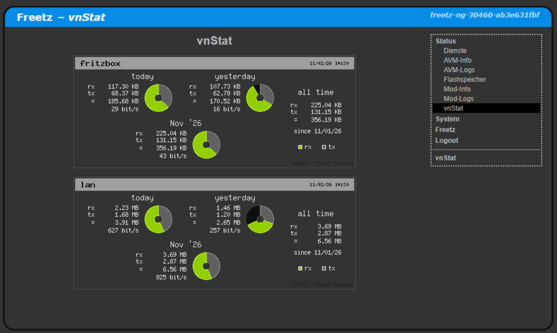

# vnStat 1.18/2.14 (binary only)
  - Homepage: [https://humdi.net/vnstat/](https://humdi.net/vnstat/)
  - Manpage: [https://humdi.net/vnstat/man/](https://humdi.net/vnstat/man/)
  - Changelog: [https://humdi.net/vnstat/CHANGES](https://humdi.net/vnstat/CHANGES)
  - Repository: [https://github.com/vergoh/vnstat](https://github.com/vergoh/vnstat)
  - Package: [master/make/pkgs/vnstat/](https://github.com/Freetz-NG/freetz-ng/tree/master/make/pkgs/vnstat/)
  - Steward: [@fda77](https://github.com/fda77)

### Dunkler Modus von v2
Den dunklen Modus gibt es nur mit v2. Zusammen mit dem dunklen Freetz-Skin sollte in der vnstat.conf `TransparentBg 1` gesetzt werden.

### Migration
Vor einem Wechsel zwischen den beiden Versionen sollte ein Backup erstellt werden!

##### Wechsel von v1 zu v2
 - Die Daten werden automatisch beim Start migriert
 - Alle alten Datein in `/var/lib/vnstat/` (ausser `vnstat.db` und `vnstat.db-journal`) sollten gelöscht werden
 
##### Wechsel von v2 auf v1
 - Ist nicht vorgesehen!
 - Oben steht dass man ein Backup machen sollte
 - Falls es dieses nicht gibt muss man es manuell versuchen
 - Die SQLite Dateien (`vnstat.db` und `vnstat.db-journal`) sollten aus `/var/lib/vnstat/` entfernt werden

